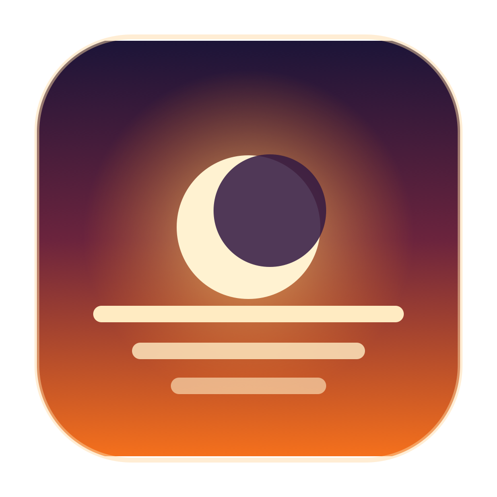
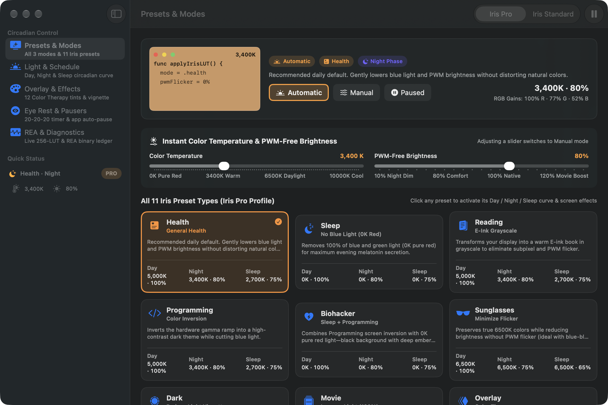
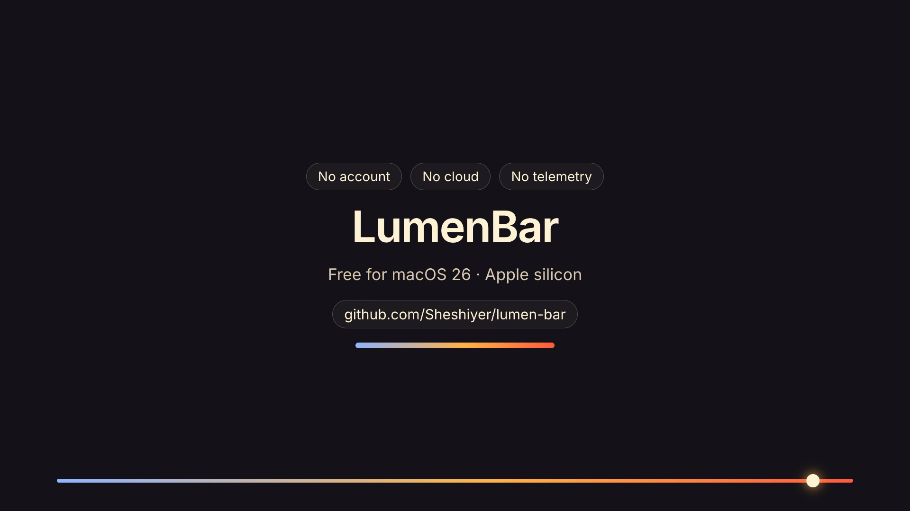
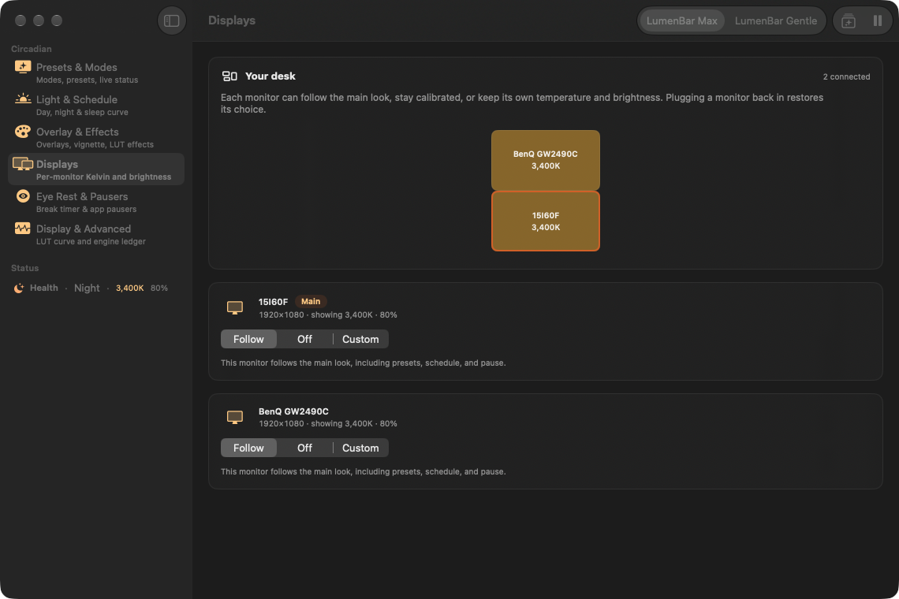

<div align="center">
  
  <h1>LumenBar</h1>
  <p><strong>Warm your Mac for easier nights.</strong></p>
  <p>A quiet menu bar app that shifts your screen toward warm light as the day ends, on every display you use.</p>
  <p><a href="https://lumenbar.thoughtseed.space">Official website</a></p>

  <a href="https://github.com/Sheshiyer/lumen-bar/releases/latest/download/LumenBar-1.2.0.dmg"></a>

  <p>
    
    
    
    
  </p>
</div>



## Why LumenBar

A bright screen at 11 PM still looks like noon to your eyes. LumenBar warms the color of your display through the evening and into sleep, so late work feels softer. It runs entirely on your Mac. There is no account, no cloud, and nothing is sent anywhere.

## Watch it

<a href="https://github.com/Sheshiyer/lumen-bar/releases/download/v1.2.0/lumenbar-explainer.mp4"></a>

- [70-second explainer](https://github.com/Sheshiyer/lumen-bar/releases/download/v1.2.0/lumenbar-explainer.mp4): why screen light at night matters and how each feature helps.
- [40-second tour](https://github.com/Sheshiyer/lumen-bar/releases/download/v1.2.0/lumenbar-onboarding.mp4): what LumenBar does on your first night.

## What it does

<table>
<tr>
<td width="50%" valign="top">

### Follows your day
Choose **Automatic** and LumenBar moves through day, night, and sleep light on its own. Pick **Manual** to hold a look, or **Pause** for 15 minutes, an hour, or until morning.

</td>
<td width="50%" valign="top">

### Every monitor, its own light
Each display can follow the main look, stay neutral, or keep its own warmth and brightness. Unplug a monitor and plug it back in, and it remembers.

</td>
</tr>
<tr>
<td width="50%" valign="top">

### Eleven ready looks
Health, Sleep, Reading, Programming, Movie, Gaming, and more, each in a stronger **Max** or softer **Gentle** version.

</td>
<td width="50%" valign="top">

### Gentle breaks
A 20-20-20 reminder covers the screen when it is time to look away, with a soft chime. Photo and video apps can pause the filter automatically.

</td>
</tr>
<tr>
<td width="50%" valign="top">

### Your whole day at a glance
See your light schedule as one curve. LumenBar estimates sunrise and sunset from your time zone, without asking for your location.

</td>
<td width="50%" valign="top">

### Reading and focus tints
Twelve color tints, a soft vignette, and a warm E-Ink paper look for long reading.

</td>
</tr>
</table>



## Install

1. [Download LumenBar 1.2.0](https://github.com/Sheshiyer/lumen-bar/releases/latest/download/LumenBar-1.2.0.dmg).
2. Open the disk image and drag **LumenBar** to **Applications**.
3. Open LumenBar. A short welcome walks you through your first setup.

LumenBar is signed and notarized by Apple, so it opens without security warnings. To check your download, compare it with the SHA-256 values listed on the [release page](https://github.com/Sheshiyer/lumen-bar/releases/latest).

**Requires** macOS 26 or later on a Mac with Apple silicon.

## Everyday use

| You want to | Do this |
|---|---|
| Pause or resume | Press `⌃⌥⌘P`, or click **Pause** in the menu bar |
| Try the next look | Press `⌃⌥⌘M` |
| Warmer or cooler | Press `⌃⌥⌘←` or `⌃⌥⌘→` |
| Brighter or dimmer | Press `⌃⌥⌘↑` or `⌃⌥⌘↓` |
| Change one monitor | Open **Displays** and choose Follow, Off, or Custom |
| Turn off sounds | **Settings → General → Quiet Sound Cues** |

## Questions

**Will this change my photo or video colors?**
Add color-critical apps under **Eye Rest & Pausers**. LumenBar returns to neutral while they are in front.

**Does LumenBar collect anything?**
No. Settings are saved in a file on your Mac. There are no accounts, analytics, or network requests.

**How do I remove it?**
Quit LumenBar from the menu bar, then move it from **Applications** to the Trash. Your screen returns to its normal colors when the app quits.

## Privacy

LumenBar runs offline. It does not use your location, contacts, camera, or microphone.

## License

Free to download and use. The source is available for reading and personal builds. See [LICENSE](LICENSE).

<details>
<summary><strong>Build from source</strong></summary>

You need Xcode with Swift 6.2 or later.

```bash
git clone https://github.com/Sheshiyer/lumen-bar.git
cd lumen-bar
./build.sh --open
```

Run checks with `swift test --scratch-path ~/Library/Developer/LumenBar/test-build` and `tools/selftest.sh`. Release packaging and notarization steps live in `tools/package.sh` and `release-contract.json`.

</details>

<div align="center">
  <sub>Made by <a href="https://thoughtseed.space">Thoughtseed</a>.</sub>
</div>
