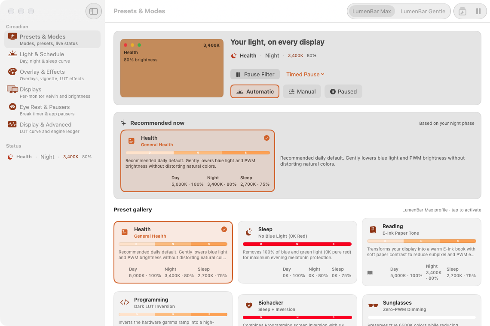

# LumenBar

Native macOS app for circadian blue-light filtering, PWM-free software brightness, and eye-comfort tooling. Everything runs locally on your Mac—no account, no cloud, no telemetry.



## Features

- **Three automation modes** — Automatic (day / night / sleep curve), Manual, and Paused, with **timed pause** (15 minutes, 1 hour, until tomorrow morning).
- **Eleven presets** — Health, Sleep, Reading, Programming, Biohacker, Sunglasses, Dark, Movie, Overlay, Gaming, and Custom, each with **LumenBar Max** or **LumenBar Gentle** intensity profiles.
- **Hardware gamma control** — 101-step Kelvin LUT (0K–10000K) applied via CoreGraphics transfer tables, with **smooth cross-fades** when switching looks.
- **Overlays & effects** — Twelve color-therapy tints, dark vignette, LUT inversion, and E-Ink-style grayscale (Reading).
- **Schedule** — Day, night, and sleep windows, 24-hour curve preview, optional **approximate solar schedule** from your time zone (no location permission).
- **Eye rest** — 20-20-20 timer with a full-screen **break overlay**; auto-pause when color-critical apps are frontmost.
- **Menu bar & shortcuts** — Live Kelvin/brightness readout, favorite presets, global shortcuts (`⌃⌥⌘P` pause, `⌃⌥⌘M` cycle preset, arrows for temperature and brightness).
- **Deep links** — `lumenbar://preset/health`, `lumenbar://mode/automatic`, `lumenbar://toggle-pause`, and related URLs.

## Requirements

- macOS 26 (see `Package.swift`; builds may run on recent macOS 15+ with matching Xcode).
- Xcode command-line tools / Xcode for `swift build` and code signing.

## Build & install

```bash
./build.sh          # build, sign, install to dist/LumenBar.app and ~/Applications/LumenBar.app
./build.sh --open   # same, then relaunch the app
```

The app icon is compiled from `Icon/AppIcon.icon` via `tools/make_icon.sh`.

## Verify

```bash
swift test --scratch-path ~/Library/Developer/LumenBar/test-build
tools/selftest.sh                    # needs APP_STORE under /tmp (script sets this)
tools/snap.sh                        # refreshes docs/screenshots (needs APP_STORE)
tools/grid-lint.sh
swift tools/check-layout.swift docs/screenshots/*-layout.json
```

Never point tests or snapshots at your real store in `~/Library/Application Support/LumenBar/`.

## Project layout

| Path | Purpose |
|------|---------|
| `Sources/LumenBar/` | SwiftUI app (window, menu bar, onboarding, settings) |
| `Sources/LumenBar/UI/` | Design tokens, shared components, sidebar pages |
| `Sources/LumenBarKit/` | Presets, Kelvin LUT, gamma builder, circadian scheduler (no SwiftUI) |
| `docs/BRIEF.md` | Product brief |
| `docs/STORIES.md` | User stories and acceptance criteria |
| `docs/screenshots/` | Light/dark UI snapshots and layout probes |
| `docs/research/` | Blue-light filter and REA research notes |

## Design

Premium-dark native UI: system materials, **Graphite** default accent (changeable in Settings → Appearance), kelvin phase strips on preset tiles, and a presets **command center** (live preview, recommended preset, gallery, collapsible adjust and verify). See `Sources/LumenBar/UI/DesignTokens.swift` and `CLAUDE.md` for contributor rules.

## License

See repository license file if present; otherwise all rights reserved by the project owner.

## Acknowledgments

Built with the [BAMA](https://github.com/daveebbelaar/bama) native Mac app workflow. Display research informed by [REA](https://github.com/morluto/rea) static analysis (ledger in **Display & Advanced** in the app).
